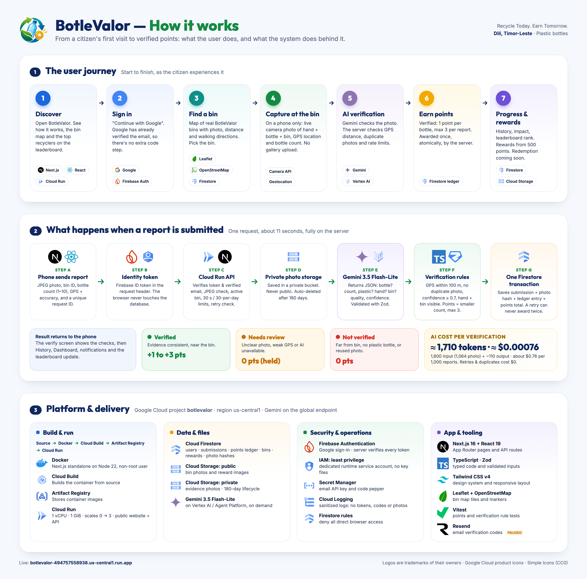

# BotleValor

**Recycle Today. Earn Tomorrow.** AI-assisted plastic-bottle recycling verification and rewards for Dili, Timor-Leste.

Next.js 16 (App Router) · TypeScript · Tailwind CSS v4 · Leaflet + OpenStreetMap · Firebase Authentication · Cloud Firestore · Cloud Storage · Gemini (`gemini-3.5-flash-lite`) on Google Cloud Agent Platform.

**Live:** <https://botlevalor-494757558938.us-central1.run.app> (Cloud Run, `us-central1`)

**Backend documentation:** see [backend.md](backend.md) for the architecture, data model, API, verification pipeline, security, deployment and operations.

**Google Cloud AI Builder Cup 2026** · Theme: **Sustainability & Social Impact** · Licensed under the [MIT License](LICENSE).

## The problem

In Dili, Timor-Leste, the government and NGOs have already installed recycling bins for plastic bottles, but many people still don't use them. BotleValor gives citizens a reason to: find a real bin, recycle bottles there, prove it with one live photo, and earn points toward future rewards. A public leaderboard makes it a community effort.

## How it works



The diagram shows the user journey from first visit to points, what happens on the server when a recycling report is submitted, and the Google Cloud platform behind it.

## Try it (notes for judges and testers)

1. Open the **live app** above and choose **Continue with Google**.
2. Explore the dashboard, the bin map, history, rewards and the leaderboard on any device.
3. **Recycle Now works on phones and tablets only**, because it needs the live camera and GPS. Photos can't be uploaded from a gallery. On a laptop, Recycle Now shows a **QR code**: scan it with your phone to continue there.
4. **Location rule:** a report is only **Verified** when the phone is within **100 m of a registered bin**. The first real bin is in front of Palacio do Governo, Dili. Reports made elsewhere are correctly marked **Not verified**, but you'll still see Gemini's analysis of the photo: bottle, hand, bin and count. A verified report recorded at the bin is shown in our demo video.

> **Sign-in:** Google sign-in only, for now. Email + password is switched off until a verified email domain exists for sending verification codes. See backend.md §3 to re-enable it.

## Run it locally

```bash
npm install
gcloud auth application-default login   # local Google Cloud credentials (browser sign-in)
cp .env.example .env.local              # then fill in your project's values (never commit .env.local)
npm run dev                             # http://localhost:3000
```

| Script | Purpose |
| --- | --- |
| `npm run dev` | Development server |
| `npm run build` / `npm start` | Production build / server |
| `npm run lint` · `npm run typecheck` · `npm test` | Quality checks (ESLint, TypeScript, Vitest) |
| `npm run seed` | Upsert the bin and reward catalogue into Firestore |

## Deploy your own copy to Google Cloud Run

These steps deploy BotleValor to **your own** Google Cloud project. The deploy uses Cloud Build with the included `Dockerfile` (Next.js `standalone`, Node 22, non-root user). The app runs with a dedicated, least-privilege service account. No key files are used, and secrets live in Secret Manager.

### Before you start

- Install the [Google Cloud CLI](https://cloud.google.com/sdk/docs/install) and Node.js 22.
- Have a Google Cloud project with **billing enabled**. Then, in the [Firebase console](https://console.firebase.google.com/), **add Firebase to that project**:
  - Enable **Authentication → Google** sign-in. Email/Password is optional, see [backend.md](backend.md) §3.4.
  - Register a **Web app** and copy its config.
- **Point the app at your Firebase project.** Copy the template and fill in your Firebase web config. These values are *public* and get built into the page; the build reads them from `.env.production`.

  ```bash
  cp .env.production.example .env.production
  # then set NEXT_PUBLIC_FIREBASE_API_KEY, _AUTH_DOMAIN, _PROJECT_ID and _APP_ID
  ```

### 1. Set your variables

```bash
export PROJECT_ID=your-project-id          # Google Cloud project ID (not the display name)
export REGION=us-central1                  # Cloud Run, Firestore and Storage region
export SERVICE=botlevalor                  # Cloud Run service name
export PUBLIC_BUCKET=$PROJECT_ID-public    # public images (bins, rewards)
export UPLOADS_BUCKET=$PROJECT_ID-uploads  # PRIVATE evidence photos
export RUN_SA=botlevalor-run@$PROJECT_ID.iam.gserviceaccount.com
export EMAIL_FROM="BotleValor <onboarding@resend.dev>"   # use an address on your verified Resend domain

gcloud auth login
gcloud config set project $PROJECT_ID
```

### 2. One-time setup

```bash
# APIs
gcloud services enable run.googleapis.com cloudbuild.googleapis.com artifactregistry.googleapis.com \
  aiplatform.googleapis.com firestore.googleapis.com storage.googleapis.com secretmanager.googleapis.com

# Firestore (Native mode). ⚠️ The location cannot be changed later.
gcloud firestore databases create --location=$REGION --type=firestore-native

# Buckets: public catalogue images + private evidence photos (auto-deleted after 180 days)
gcloud storage buckets create gs://$PUBLIC_BUCKET --location=$REGION --uniform-bucket-level-access
gcloud storage buckets add-iam-policy-binding gs://$PUBLIC_BUCKET --member=allUsers --role=roles/storage.objectViewer
echo '{"rule":[{"action":{"type":"Delete"},"condition":{"age":180,"matchesPrefix":["submissions/"]}}]}' > /tmp/bv-lifecycle.json
gcloud storage buckets create gs://$UPLOADS_BUCKET --location=$REGION --uniform-bucket-level-access \
  --public-access-prevention --lifecycle-file=/tmp/bv-lifecycle.json

# Runtime service account with least privilege
gcloud iam service-accounts create botlevalor-run --display-name="BotleValor Cloud Run runtime"
gcloud projects add-iam-policy-binding $PROJECT_ID --member="serviceAccount:$RUN_SA" --role=roles/datastore.user --condition=None
gcloud projects add-iam-policy-binding $PROJECT_ID --member="serviceAccount:$RUN_SA" --role=roles/aiplatform.user --condition=None
gcloud storage buckets add-iam-policy-binding gs://$UPLOADS_BUCKET --member="serviceAccount:$RUN_SA" --role=roles/storage.objectAdmin

# Secrets. The Resend key is typed at a hidden prompt, so it never appears on screen or in shell history.
read -rs -p "Resend API key: " RESEND_KEY && echo
printf '%s' "$RESEND_KEY" | gcloud secrets create resend-api-key --replication-policy=automatic --data-file=-
openssl rand -hex 32 | tr -d '\n' | gcloud secrets create email-code-pepper --replication-policy=automatic --data-file=-
unset RESEND_KEY
for s in resend-api-key email-code-pepper; do
  gcloud secrets add-iam-policy-binding $s --member="serviceAccount:$RUN_SA" --role=roles/secretmanager.secretAccessor
done

# Firestore security rules: deny all direct client access (the server API does everything).
# firebase-tools has its own browser sign-in, separate from gcloud.
npx firebase-tools@latest login
npx firebase-tools@latest deploy --only firestore:rules --project $PROJECT_ID

# Seed the bin + reward catalogue (uploads images to $PUBLIC_BUCKET)
gcloud auth application-default login
GOOGLE_CLOUD_PROJECT=$PROJECT_ID GCS_PUBLIC_BUCKET=$PUBLIC_BUCKET node scripts/seed-firestore.mjs
```

### 3. Deploy (and redeploy after every change)

Run this the first time and again after every code change:

```bash
gcloud run deploy $SERVICE \
  --source . \
  --project=$PROJECT_ID \
  --region=$REGION \
  --service-account=$RUN_SA \
  --allow-unauthenticated \
  --port=8080 \
  --cpu=1 --memory=1Gi \
  --concurrency=40 \
  --timeout=60 \
  --min-instances=0 --max-instances=3 \
  --cpu-throttling \
  --execution-environment=gen2 \
  --set-env-vars="GOOGLE_CLOUD_PROJECT=$PROJECT_ID,GEMINI_MODEL=gemini-3.5-flash-lite,GEMINI_LOCATION=global,GCS_PUBLIC_BUCKET=$PUBLIC_BUCKET,GCS_UPLOADS_BUCKET=$UPLOADS_BUCKET,EMAIL_FROM=$EMAIL_FROM,NEXT_PUBLIC_EMAIL_PASSWORD_AUTH=false" \
  --set-secrets="RESEND_API_KEY=resend-api-key:latest,EMAIL_CODE_PEPPER=email-code-pepper:latest"
```

| Flag | Why |
| --- | --- |
| `--min-instances=0` | Scales to zero, so the service costs nothing when idle |
| `--max-instances=3` | Caps cost |
| `--timeout=60` | One AI verification takes about 11 s |
| `--cpu-throttling` | CPU is only billed during requests |
| `--allow-unauthenticated` | Makes the website public. The API checks Firebase sign-in on every protected route. |

### 4. After the first deploy

1. Copy the **Service URL** printed by the deploy. In Firebase console → **Authentication → Settings → Authorized domains**, add its domain, for example `botlevalor-xxxx.us-central1.run.app`. Google sign-in won't work on the live site without this.
2. In Google Cloud console → **APIs & Services → Credentials**, restrict the Firebase **browser API key** to your domains (HTTP referrers). This is recommended.
3. Create a **budget alert** under Billing → Budgets & alerts. It notifies you; it does not cap spending.
4. Optionally, map a custom domain to the Cloud Run service, and add that domain to the authorized domains too.

Check the service later with:

```bash
gcloud run services describe $SERVICE --region=$REGION --format="value(status.url)"
gcloud logging read 'resource.type="cloud_run_revision" AND resource.labels.service_name="'$SERVICE'" AND severity>=ERROR' --limit=20
```

## Routes

| Route | Screen |
| --- | --- |
| `/` | Landing (includes the public points leaderboard) |
| `/login`, `/signup` | Google sign-in. `/verify` (6-digit email code) redirects to `/login` while email sign-in is off |
| `/dashboard` | Dashboard |
| `/bins` | Recycling bin map (OpenStreetMap). `?bin=<id>` opens a bin |
| `/recycle/capture` | Live rear-camera evidence capture on phones and tablets only. Laptops get a QR code |
| `/recycle/verify` | Upload + AI verification result |
| `/recycle/success` | Points earned |
| `/history`, `/rewards`, `/profile`, `/settings` | History, rewards catalogue, profile, settings |

## AI verification cost (Gemini 3.5 Flash-Lite)

Each recycling report makes **one** Gemini call: one photo plus the instruction prompt, returning a small JSON assessment. Token counts were measured on 16 Oct 2026 with the exact production prompt and schema, using `gemini-3.5-flash-lite` on the `global` Agent Platform endpoint:

| Part of one verification | Tokens |
| --- | --- |
| Photo (fixed per image: the same for 1080×810, 1200×1600 and 1600×1200) | 1,064 |
| Prompt text + JSON schema | 536 |
| **Input total** | **1,600** |
| Output (JSON answer) | ~110 (capped at 400) |
| Thinking tokens | 0 |
| **Total per verification** | **≈ 1,710** |

**Price** (Google list price, Standard paid tier): **$0.30 per 1M input tokens** and **$2.50 per 1M output tokens**. Thinking tokens are billed as output.

| | Cost (USD) |
| --- | --- |
| Input: 1,600 × $0.30 / 1M | $0.00048 |
| Output: ~110 × $2.50 / 1M | $0.000275 |
| **Per verification** | **≈ $0.00076** (worst case with the 400-token output cap: ≈ $0.0015) |
| Per 1,000 verifications | ≈ $0.76 |
| Per 10,000 verifications | ≈ $7.60 |
| Per 100,000 verifications | ≈ $76 |

Some calls cost nothing:

- A **retried** request with the same request ID returns the stored result without calling Gemini.
- A **reused photo** is rejected as a duplicate before Gemini is called.

Notes:

- Prices are from Google's [Gemini API pricing](https://ai.google.dev/gemini-api/docs/pricing). Third-party Vertex AI price listings show the same Agent Platform rate. Confirm it on Google Cloud's [Agent Platform pricing page](https://cloud.google.com/vertex-ai/generative-ai/pricing) and in **Billing → Reports**, because prices, credit eligibility and taxes can change.
- Every submission stores its actual token usage in Firestore (`users/{uid}/submissions/{id}.ai.usage`), so real costs can be audited.
- Batch (asynchronous) processing is listed at half price, but verification needs an immediate answer, so it uses the standard tier.
- This covers Gemini only. Cloud Run, Firestore, Cloud Storage and Resend are billed separately; see [backend.md](backend.md) §12.

## Points & rewards

- Each verified report earns **1–3 points**: 1 point per bottle, capped at 3 per report ([`src/lib/points.ts`](src/lib/points.ts)).
- Points are decided and awarded **only on the server**, at most once per submission, through a Firestore ledger.
- Rewards start at **500 points**. Redemption is disabled until a redemption backend and real partners exist.
- The landing page shows a **public leaderboard** of the top 10 recyclers by points. It shows only first names and last initials, and users can hide themselves in Settings.

## License

BotleValor's source code is released under the [MIT License](LICENSE).

Third-party names and logos shown in the diagram, including Google Cloud, Firebase, Gemini, Next.js and others, are trademarks of their respective owners. They are used only to identify the technologies this project uses.
